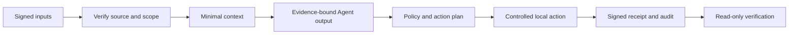

# NOVA One Digital Trust Infrastructure

**Verifiable evidence in. Controlled actions out.**

NOVA One is an independent, Apache-2.0 engineering toolkit for evidence-bound Agent workflows: signed inputs, scoped context, structured Agent output, local policy, controlled execution and verifiable receipts.

[Playground](https://enjoytime1101-spec.github.io/nova-one/) · [Download v0.3.0](https://github.com/enjoytime1101-spec/nova-one/releases/tag/v0.3.0) · [Agent / Skill setup](docs/agent-integration.md) · [Contributing](CONTRIBUTING.md)

**Status: local reference software, v0.3.0.** The runnable example uses synthetic data and a deterministic Agent, with cryptographic signing and verification. Real source/model adapters require explicit configuration; external webhook execution and business zero-knowledge predicates remain disabled. See the [capability matrix](docs/requirements-acceptance-matrix.md).

## Run in two minutes

Use Node.js 20+ and npm. No model subscription, cloud account or API key is needed for the local example.

```bash
git clone https://github.com/enjoytime1101-spec/nova-one.git
cd nova-one
npm ci
npm run demo
```

The example runs the real Node engine in an isolated temporary directory, verifies its Agent credential, records a local action and prints the audit checkpoint. It removes its temporary keys afterward. Synthetic evidence is marked `untrusted-fixture`; agreement between two fixtures does not make them independent real-world sources.

## Automate a complete workflow

The [editable task](workflows/local-record.json) is the input to a versioned runner. Inspect it, preview the plan, execute with a stable run key, then verify the report without repeating the action.

```bash
export NOVA_HOME="$PWD/.nova"
node bin/nova-one.mjs init --issuer https://issuer.example

# Preview: no action is executed.
node bin/nova-one.mjs automation --file workflows/local-record.json

# Execute the local task and save its report.
node bin/nova-one.mjs automation --file workflows/local-record.json \
  --execute --run-key first-review --out .nova/report.json

# Read-only verification against the task and local trust store.
node bin/nova-one.mjs automation verify --file .nova/report.json \
  --task workflows/local-record.json --run-key first-review
```

Keep the same run key for a retry of the same task; use a new key for a new intended action. Failed commands exit nonzero. `NOVA_HOME` contains private keys, state and authentication configuration. Initialization reveals the generated API token once; keep it private. Never commit runtime state or paste its contents into an issue.

Read [Automation](docs/automation.md) for the schema, policy, dry-run, retry, failure and receipt semantics.



## Use it from an Agent

| Interface | What you receive | Setup |
| --- | --- | --- |
| **Skill** | Focused workflow with executable CLI fallback and verification steps | [Install and invoke](docs/agent-integration.md) |
| **Prompt Block** | Portable evidence and action contract for an existing Agent | [Prompt Block](skills/nova-one-trust-workflow/prompts/verified-action-block.md) |
| **MCP** | Standard stdio server, read-only by default with explicit local write configuration | [Host configuration](docs/agent-integration.md) |
| **JavaScript SDK** | Composable credential, source, context, workflow, action and audit primitives | [SDK](docs/sdk.md) |
| **HTTP** | Bearer-protected loopback integration API | [API contract](docs/http-api.md) |

The legacy JSONL bridge remains distinct from the standard MCP entry point. A Skill or model suggestion never overrides runtime controls. This release does not publish a hosted GPT or an internet-facing GPT Action endpoint.

## Install a release archive

Download the npm tarball and `SHA256SUMS` from the [release page](https://github.com/enjoytime1101-spec/nova-one/releases/tag/v0.3.0), verify the checksum, then install:

```bash
npm install --global ./nova-one-digital-trust-0.3.0.tgz
nova-one --help
nova-one-mcp --help
```

The source archive includes the dependency lockfile. Use a source checkout with `npm ci` to reproduce exact transitive versions. Installing the npm tarball uses your consumer project's resolution. npm registry publication is not required and is not claimed.

## Explore the browser Playground

```bash
npm run playground
```

Open the printed URL. The [online version](https://enjoytime1101-spec.github.io/nova-one/) is a static GitHub Pages site. It uses browser-generated keys and actual Web Crypto signing and verification, with tampering and failure cases. It does not contact a model, accept production credentials or run the Node service. Browser receipts have their own profile; they are not admitted NOVA service credentials.

The [design system](docs/design-system.md) documents grids, typography, colors and state semantics. The same source works locally and on Pages without private configuration.

## Engineering core

- Ed25519-signed credentials, source snapshots, Agent-output bindings, action receipts and Merkle audit checkpoints.
- Scope, expiry, issuer, local admission, status and replay checks, with signed local security projections.
- RFC 9901 selective-disclosure mechanics through `@sd-jwt/core`, under a custom NOVA application profile.
- Evidence freshness, conflict detection, minimal claims and constrained structured Agent outputs.
- Versioned automation tasks, dry-run, idempotent local execution and saved report verification.
- Local storage coordination, atomic writes and recorded workflow failures.
- Encrypted offline recovery shares through a maintained Shamir library.
- CLI, SDK, loopback HTTP, MCP, Skill, Prompt Block, tests, CI, locked SBOM and release packaging.

## Trust boundaries

Signatures establish integrity and key control, not truth, fairness or legal compliance. Local keys and an audit chain do not protect against a compromised host or whole-directory rollback. A caller-provided actor label is not independently authenticated organizational approval.

This version does not implement production database availability, tenant RBAC, KMS/HSM custody, external action reconciliation, independently authenticated approvals or witnesses, holder-bound SD-JWT, federated standard credential status or mathematical business ZKP. The [original requirements matrix](docs/original-requirements-matrix.md) keeps these broader objectives visible. Do not present this package as certified, production accepted or a complete compliance solution.

## Develop, verify and contribute

```bash
npm ci
npm run check
npm test
npm run demo
npm run pack:check
npm run test:package
```

CI verifies Node.js 20, 22 and 24, audits dependencies and tests the installed npm archive. The release workflow builds source, npm and Skill archives with checksums. Direct dependencies are pinned; the [SBOM](docs/sbom.cdx.json) covers the complete locked graph.

Read [CONTRIBUTING.md](CONTRIBUTING.md), [SECURITY.md](SECURITY.md), [architecture](docs/architecture.md) and [v0.3.0 release notes](docs/release-notes-0.3.0.md). Contributions are licensed under [Apache-2.0](LICENSE).
